# REDAXO Issue Tracker

**Wünsche, Fehler und Fragen rund um die Website an einem Ort – im Backend wie im Frontend.**

Der Issue Tracker bringt Redaktion, Agentur und Kundschaft zusammen: Themen anlegen und besprechen, Aufgaben verteilen,
Projekte bündeln, Wissen sammeln und private Nachrichten austauschen. Ab Version 3 auch direkt auf der Website:
Redakteure und eingeladene Gäste kommentieren Seiten und einzelne Elemente, jede Anmerkung wird ein Thema.

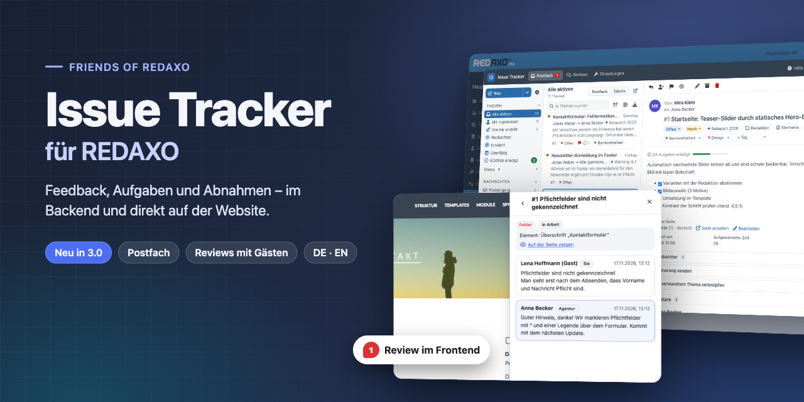

## Auf einen Blick

- **Postfach wie Mail** – Ordner links, Liste mit Vorschau in der Mitte, Lesebereich rechts; alternativ als Tabelle
- **Review im Frontend** – Seite oder Element anklicken, kommentieren, diskutieren; auch für externe Gäste per Einladung
- **Themen** mit Status, Priorität, Kategorie, Tags, Fälligkeit, Zuständigkeit, betroffener Seite und Anhängen
- **Kommentare** mit Antworten, @Erwähnungen, internen Notizen, Lösung markieren, Checklisten, Zeiterfassung und #Verweisen
- **Projekte** als Ordner, **Wissen** für dauerhafte Anleitungen, **private Nachrichten** und Rundschreiben
- **E-Mail-Benachrichtigungen** mit anpassbaren Vorlagen und Deep Links
- **Vollbild-App** über dem Backend, von jeder Seite aus erreichbar
- Deutsch und Englisch, helles und dunkles Theme, per Tastatur bedienbar

---

## Neu in 3.0: Review im Frontend

Wer eine Website abnimmt, sieht sich die Seiten an – und genau dort entsteht das Feedback. Mit dem Review im Frontend
kommentieren Redaktion, Kundschaft oder eingeladene Gäste direkt auf der Website. Jede Anmerkung wird ein Thema im
Issue Tracker; besprochen wird auf der Seite oder im Backend, ganz wie es jedem lieber ist.

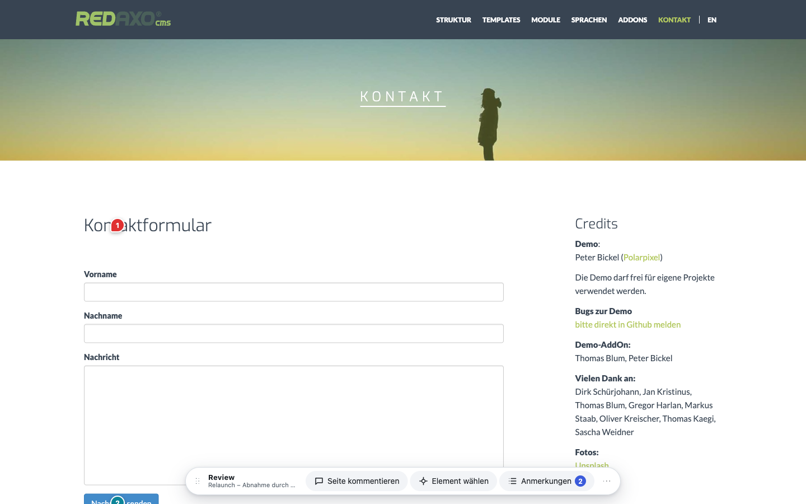

**Element wählen** – das Element unter der Maus wird hervorgehoben und benannt. Ein Klick öffnet das Formular.
Pfeil ↑/↓ wählt das umgebende bzw. innere Element, Esc bricht ab.

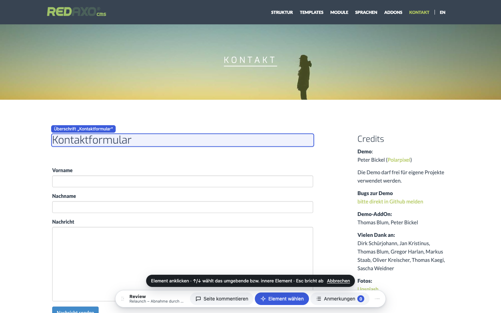

**Anmerkung schreiben** – Art wählen (Anmerkung, Wunsch, Fehler, Frage), Text eingeben, optional einen
Bildschirmausschnitt anhängen. Die Seitenleiste öffnet sich auf der Seite gegenüber dem Element, damit das beanstandete
Element sichtbar bleibt.

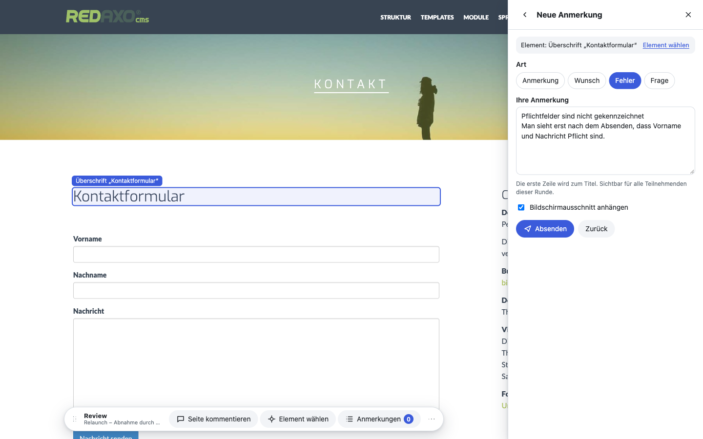

**Diskutieren** – nummerierte Marker zeigen die Anmerkungen auf der Seite. Antworten der Agentur aus dem Backend
erscheinen direkt im Gesprächsverlauf, Gäste werden per E-Mail informiert.

| Gesprächsverlauf | Alle Anmerkungen der Runde |
|---|---|
| 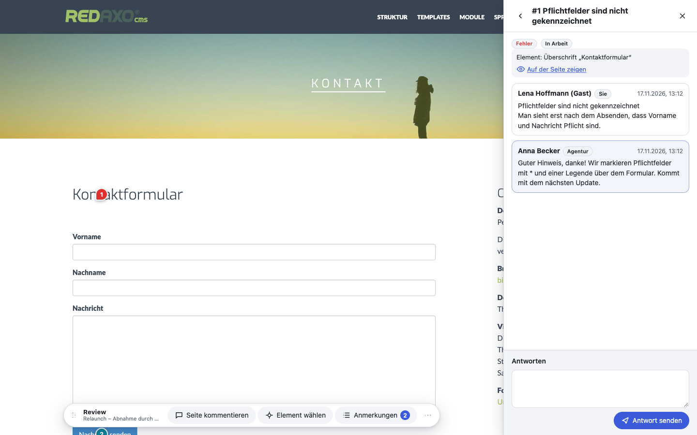 | 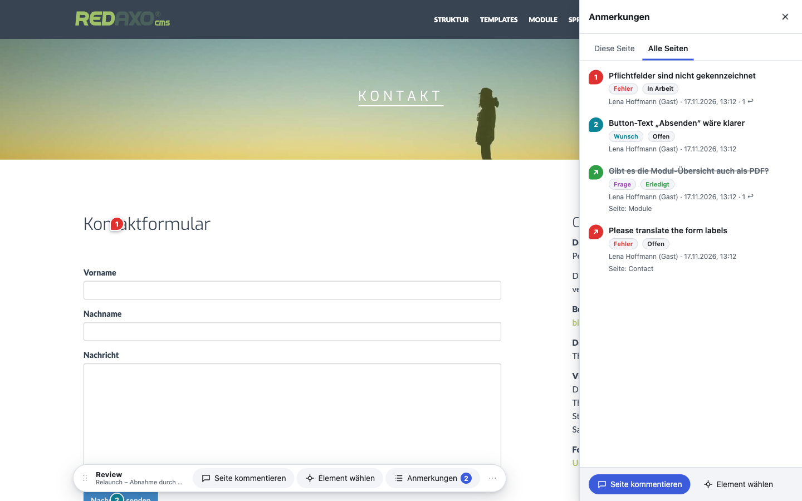 |

| Englische Seite | Handy |
|---|---|
| 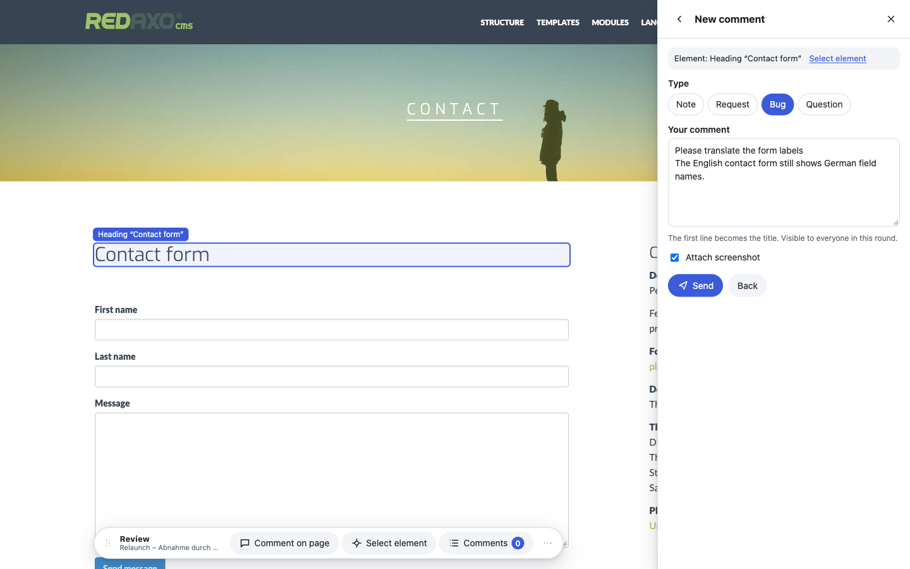 | 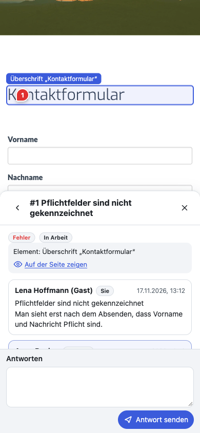 |

**Im Backend** steht bei jeder Anmerkung, wo sie sitzt: Runde, Element, „Im Frontend zeigen“ (springt zum Marker),
„Slice bearbeiten“, Fenstergröße und Browser. Hat sich der Abschnitt seitdem geändert, steht das dabei.

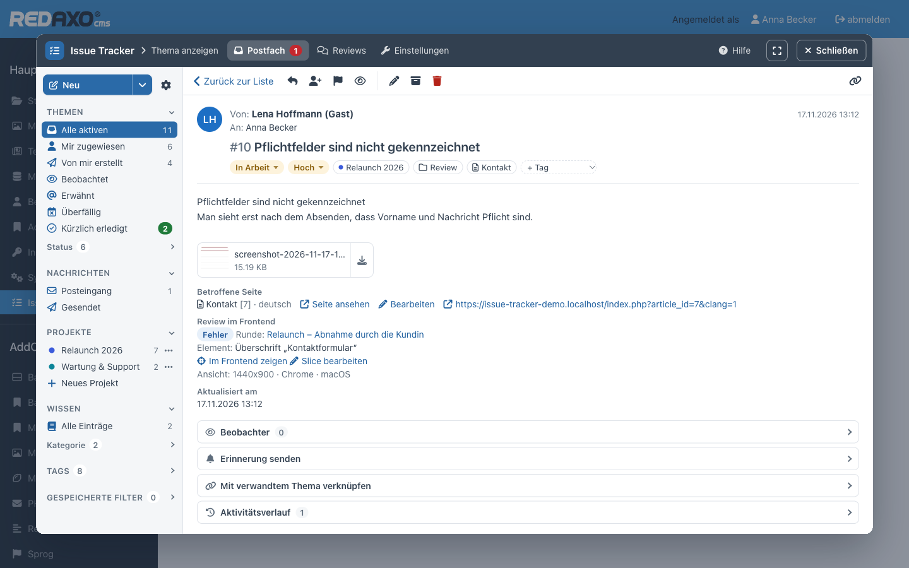

### Review-Runden und Gäste

Unter **Issue Tracker → Reviews** (Recht `issue_manager`) legt man Runden an: Titel, Hinweise für die Teilnehmenden,
Projekt, Zuständigkeit, Kategorie (Standard „Review“), Seiten (leer = ganze Website), Startseite und Ablaufdatum.

- **Backend-Benutzer** nehmen über ihre Anmeldung teil. Admins und Issue-Manager sehen alle aktiven Runden.
- **Gäste** werden mit Name und E-Mail eingeladen und bekommen einen persönlichen Link. Er lässt sich neu erzeugen,
  erneut versenden oder sofort sperren. Gäste brauchen kein Konto.
- **Sichtbarkeit**: Alle Teilnehmenden einer Runde sehen alle Anmerkungen der Runde – so gibt es keine Doppelmeldungen.
  Interne Kommentare sehen Gäste nie.

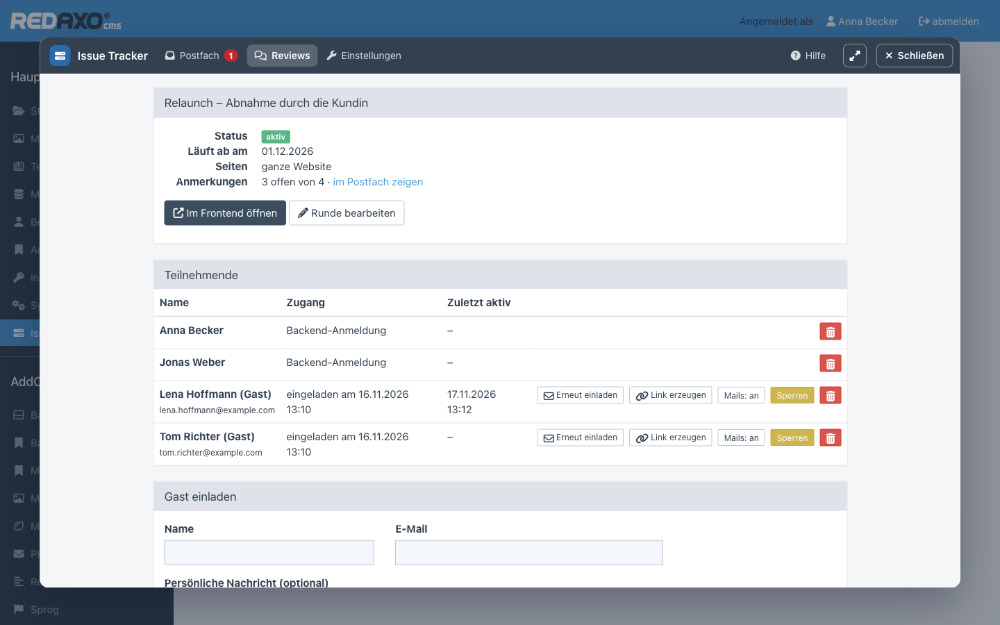

### Die Leiste

- Web Component `<it-review-bar>` im Shadow DOM – die Stile der Website wirken nicht hinein und nicht heraus
- Bar oben oder unten zentriert, am Griff frei verschiebbar (auch mit den Pfeiltasten; Pos1 oben, Ende unten)
- **Leiste ausblenden** macht daraus eine kleine Schaltfläche; **Review-Modus beenden** blendet alles aus
  (Gäste werden abgemeldet; Backend-Benutzer schalten ihn über „Im Frontend öffnen“ wieder ein)
- Seitenleiste als Overlay, auf dem Handy als Blatt von unten
- Sprache folgt der Sprache der Seite (Deutsch/Englisch)

### Wie eine Anmerkung an ihrem Element hängt

- **Slice**: Für Reviewer setzt die Ausgabe unsichtbare Marker (`<!--it-slice:ID-->`) um jeden Slice. Besucher bekommen
  davon nichts – keine Marker, keine Leiste, kein Skript.
- **Element**: CSS-Pfad, Textausschnitt und Klickposition. Fehlt das Element später, sucht die Leiste über den Text,
  dann über den Slice; sonst gilt die Anmerkung für die Seite.
- **Änderungen**: Eine Prüfsumme des Slice-Inhalts zeigt „Abschnitt seitdem geändert“ bzw. „entfernt“.
- **Bildschirmausschnitt**: im Browser erzeugt ([modern-screenshot](https://github.com/qq15725/modern-screenshot), MIT),
  Element rot eingerahmt, als Anhang am Thema.

### Sicherheit

- Persönliche Links: gespeichert wird nur ein Hash des Schlüssels; Ablauf, Sperren wirkt sofort
- Nach dem ersten Aufruf ein HttpOnly-Cookie; der Schlüssel verschwindet aus der Adresse
- Anfragen der Leiste nur mit eigener Kopfzeile und passender Herkunft, Honigtopf-Feld, Begrenzung je Person
- Seiten mit Leiste werden nicht zwischengespeichert und nicht indexiert (`no-store`, `noindex`)

---

## Themen

### Postfach

Ordner links (Alle aktiven, Mir zugewiesen, Von mir erstellt, Beobachtet, Erwähnt, Überfällig, Kürzlich erledigt,
Status, Projekte, Wissen, Tags, gespeicherte Filter), die Liste mit Vorschau in der Mitte, rechts der Lesebereich.
Mit ↑/↓ blättern, mit R antworten, mit T Tags direkt in der Liste setzen, mit ? alle Tastenkürzel anzeigen.

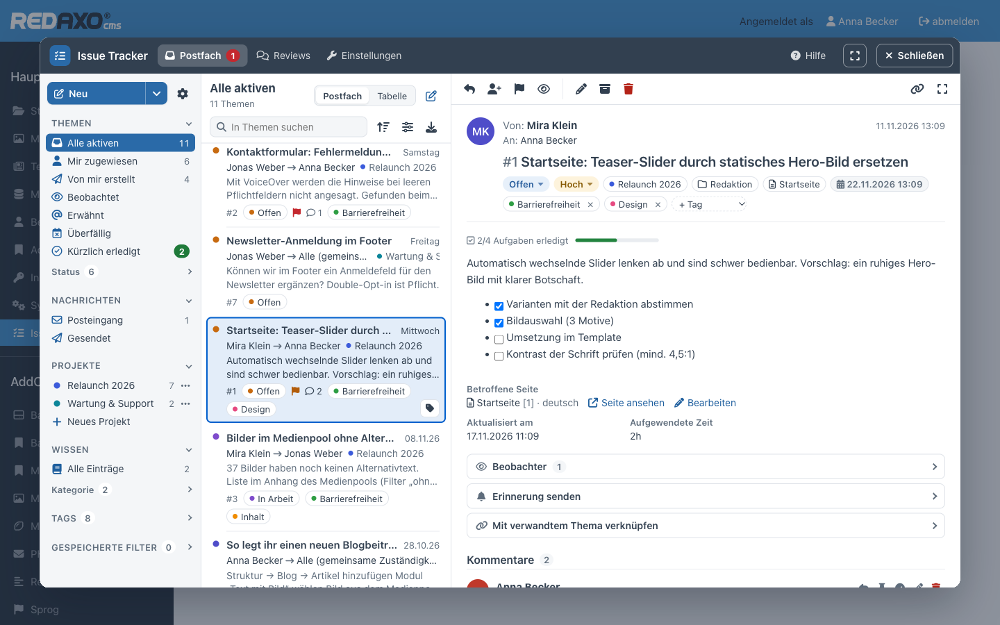

Wer lieber die klassische Tabelle mag, schaltet oben auf „Tabelle“ um – sortierbar über die Spaltenköpfe.

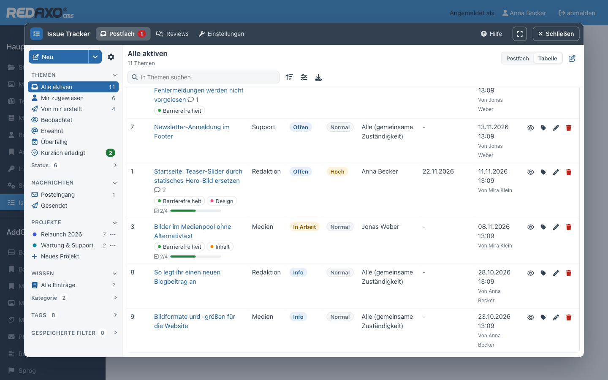

### Ein Thema lesen und bearbeiten

Status und Priorität über die Pill im Kopf, Tags über „+ Tag“, dazu Zuweisen, Beobachten, Erinnern, Bearbeiten,
Erledigen und Löschen in der Symbolleiste. Checklisten lassen sich direkt abhaken, der Fortschritt steht darüber.

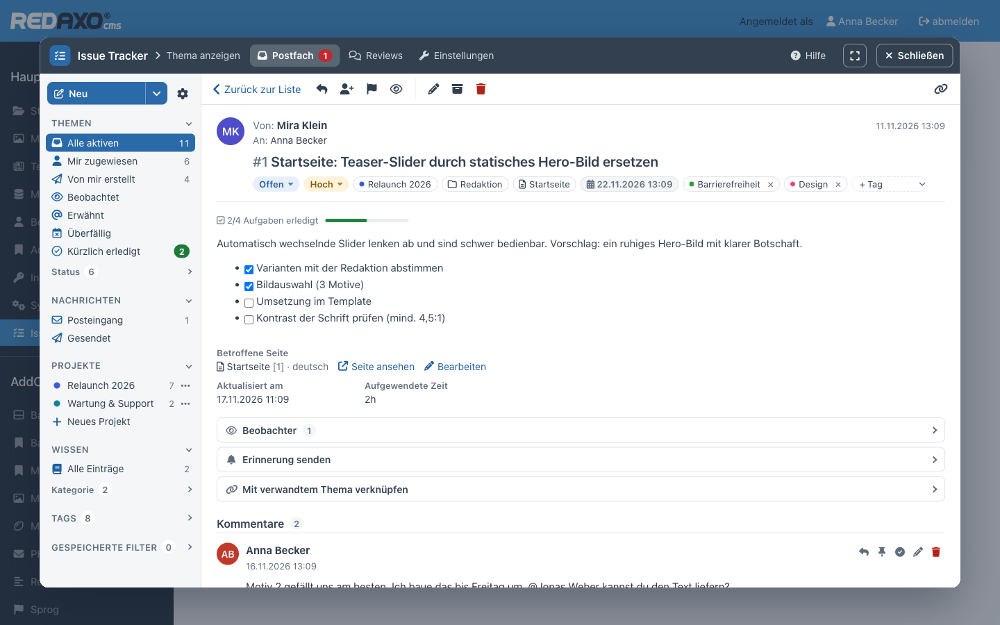

- **Kommentare** mit Antworten, Anheften und „Als Lösung markieren“; **interne Kommentare** nur für Admins und Manager
- **„Antworten und erledigen“** schließt das Thema mit der Antwort – eine Mail statt zwei
- **@Erwähnungen** mit Autovervollständigung und Benachrichtigung
- **Checklisten** `- [ ] Aufgabe` / `- [x] erledigt` – per Klick abhaken, Fortschrittsbalken in Liste und Ansicht
- **Zeiterfassung** mit `/spent 1h 30m` im Kommentar; die Summe steht im Thema
- **#Verweise** wie `#42` werden zu Links, das andere Thema bekommt einen Eintrag im Verlauf
- **Aktivitätsverlauf** aller Änderungen, **Beobachter**, **Erinnerung** an die zuständige Person (mit Sperrfrist)
- **Verwandte Themen** und **Duplikate** verknüpfen
- **Anhänge**: Bilder, Videos, Dokumente, Druckdaten (`.indd`, `.eps`), Archive – mit Lightbox; nur für angemeldete
  Benutzer abrufbar, die das Thema sehen dürfen

### Neues Thema

Über **Neu** in der Seitenleiste oder **Neues Thema** in der Kopfzeile jeder Backend-Seite. Zuständigkeit, Status,
Priorität, Kategorie, Projekt, Fälligkeit, Tags und betroffene Seite stehen oben als Leiste bereit; Dateien einfach in
das Fenster ziehen. Beim Bearbeiten eines Artikels ist er als betroffene Seite vorbelegt, die Backend-Seite, von der
aus gemeldet wurde, wird mitgespeichert.

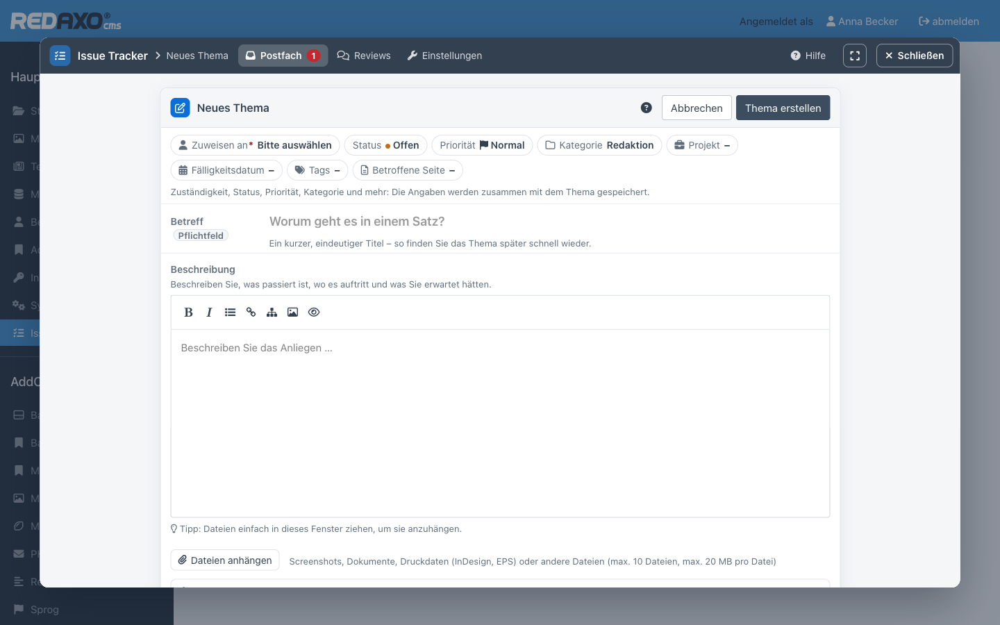

Unter „Weitere Angaben“: privat (nur Admins), AddOn, Version, YRewrite-Domains und YForm-Tabellen.

### Projekte, Wissen, Nachrichten

- **Projekte** sind Ordner in der Seitenleiste – mit Farbe, Fälligkeit, Mitgliedern (Owner, Mitglied, Beobachter) und
  Archiv. Benutzer sehen nur ihre Projekte, Admins alle.
- **Wissen** sammelt Anleitungen und Antworten, die dauerhaft nützlich sind (Themen mit Status „Info“), nach Kategorie.
- **Nachrichten**: private Unterhaltungen zwischen Benutzern – Posteingang, Gesendet, Antworten, Weiterleiten,
  ungelesen markieren. Admins schicken **Rundschreiben** in den Posteingang, per E-Mail oder beides.

| Wissen | Nachrichten |
|---|---|
| 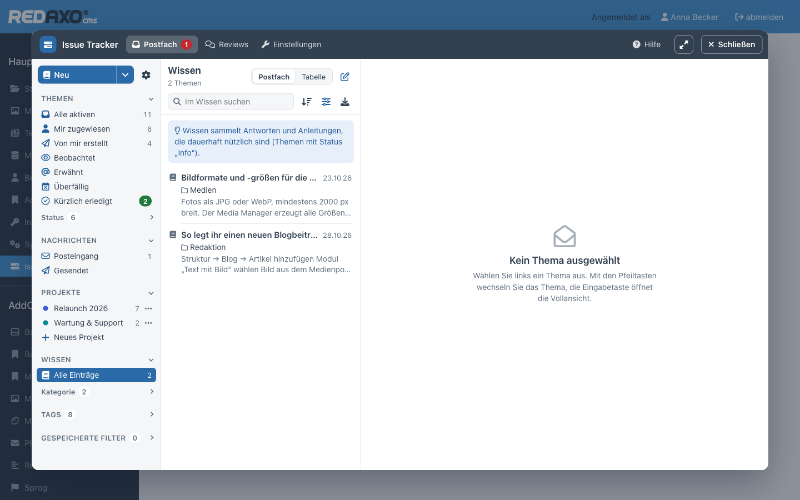 | 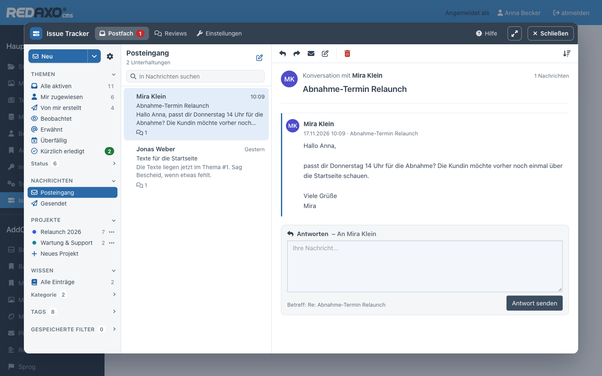 |

### Vollbild-App

Der Issue Tracker öffnet sich als eigene Ebene über dem Backend – mit eigener Kopfleiste und „Schließen“ (oder Esc),
das zur vorherigen Seite zurückführt. Erreichbar über den Menüpunkt und die Knöpfe **Issue Tracker** und
**Neues Thema** in der Kopfzeile jeder Backend-Seite. Abschaltbar in den Einstellungen.

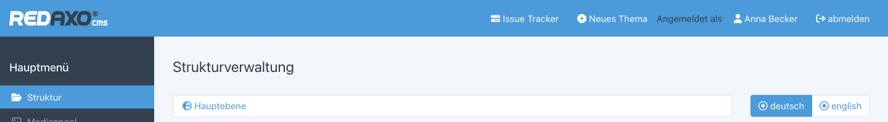

### Filter, Suche, Export

- Suche in Titel und Beschreibung, Sortierung, Filter nach Status, Kategorie, Tag, Ersteller, Zuständigkeit und Projekt
- Filter bleiben während der Sitzung erhalten und lassen sich speichern und als Standard festlegen
- CSV-Export und PDF-Export (mit dem AddOn PdfOut) berücksichtigen die aktuellen Filter
- Schnittstelle für Statistiken mit API-Token, siehe [api.md](api.md)

### E-Mail-Benachrichtigungen

- bei neuen Themen, Kommentaren, Statusänderungen, Zuweisungen, Erwähnungen und privaten Nachrichten
- jede Person stellt ihre Benachrichtigungen selbst ein (Zahnrad → „Meine Benachrichtigungen“)
- HTML-Vorlagen auf Deutsch und Englisch, anpassbar unter **Einstellungen → E-Mail-Templates**
- Deep Links mit Einmal-Token (30 Tage gültig)
- Review-Gäste bekommen Einladung, Antworten und Statusänderungen mit persönlichem Link direkt zur Stelle

---

## Installation

1. Im Backend unter **Installer** das AddOn „issue_tracker“ herunterladen, installieren und aktivieren
   (benötigt REDAXO ab 5.15, PHP ab 8.1 und PHPMailer)
2. Berechtigungen vergeben (siehe unten)
3. Unter **Einstellungen** E-Mail-Versand, Absender und Kategorien prüfen

Bei der Installation werden die Media-Manager-Typen `issue_tracker_attachment` (Anhänge) und
`issue_tracker_thumbnail` (Vorschaubilder) angelegt, siehe [MEDIA_MANAGER.md](MEDIA_MANAGER.md).

### Berechtigungen

| Recht | Was es erlaubt |
|---|---|
| `issue_tracker[]` | Zugriff auf den Issue Tracker |
| `issue_tracker[issuer]` | Themen anlegen und kommentieren |
| `issue_tracker[issue_manager]` | alle Themen bearbeiten und löschen, Wissen pflegen, Projekte und Review-Runden anlegen |
| `admin` | Vollzugriff inkl. Einstellungen, private Themen, Rundschreiben |

### Einstellungen

- **Kategorien**, **Menü-Titel** (z. B. „Support“ oder „Anfragen“), Tags
- **E-Mail**: Versand an/aus, Absendername und -adresse (sonst PHPMailer), Sperrfrist für Erinnerungen
- **E-Mail-Templates** mit Platzhaltern wie `{{issue_title}}`, `{{comment_text}}`, `{{issue_url}}`, `{{affected_page}}`
- **Als Vollbild öffnen** an/aus
- **Backup/Export** aller Daten

Eine ausführliche Anleitung für Redakteure steht im Backend unter **Hilfe** ([manual.md](manual.md)).

---

## Technisches

### Datenbank-Tabellen

| Tabelle | Inhalt |
|---|---|
| `rex_issue_tracker_issues` | Themen |
| `rex_issue_tracker_comments` | Kommentare |
| `rex_issue_tracker_attachments` | Anhänge |
| `rex_issue_tracker_tags`, `…_issue_tags` | Tags und Zuordnung |
| `rex_issue_tracker_projects`, `…_project_users` | Projekte und Mitglieder |
| `rex_issue_tracker_messages` | private Nachrichten |
| `rex_issue_tracker_history` | Aktivitätsverlauf |
| `rex_issue_tracker_watchers`, `…_mentions`, `…_reminders` | Beobachter, Erwähnungen, Erinnerungen |
| `rex_issue_tracker_time_entries` | Zeiterfassung (`/spent`) |
| `rex_issue_tracker_saved_filters`, `…_notifications`, `…_settings`, `…_email_tokens` | Filter, Benachrichtigungen, Einstellungen, Deep-Link-Token |
| `rex_issue_tracker_review_rounds` | Review-Runden |
| `rex_issue_tracker_review_participants` | Teilnehmende (Backend-Benutzer und Gäste) |
| `rex_issue_tracker_review_links` | persönliche Links der Gäste (nur Hash) |
| `rex_issue_tracker_review_anchors` | Position der Anmerkungen (Seite, Slice, Element) |
| `rex_issue_tracker_review_hits` | Begrenzung der Anfragen |

Themen und Kommentare von Gästen haben `created_by = 0` und `guest_id` (Teilnehmende der Runde).

### PHP-Klassen (Namespace `FriendsOfREDAXO\IssueTracker`)

- `Issue`, `Comment`, `Attachment`, `Tag`, `Project`, `Message` – Modelle (`getAuthorName()` liefert Benutzer oder „Name (Gast)“)
- `NotificationService`, `EmailTemplateService`, `HistoryService`, `SavedFilterService`, `PermissionService`
- `AppShell` (Vollbild-App), `ContentRenderer` (Markdown, Checklisten, #Verweise), `UiHelper`
- `Review\Round`, `Review\Participant`, `Review\Links`, `Review\Reviewer` – Runden, Teilnehmende, Links, Zugang im Frontend
- `Review\ReviewService` – Anmerkung anlegen, beantworten, für eine Seite auflisten
- `Review\Frontend` – Leiste ausgeben (`OUTPUT_FILTER`), Slice-Marker (`SLICE_SHOW`)
- `Review\Mailer` – Einladungen und Benachrichtigungen an Gäste
- API: `rex_api_issue_tracker_review` (Leiste), `…_link`, `…_tags`, `…_export`, `…_stats`, `…_generate_token`

### Assets

- `assets/css/it-*.css`, `assets/js/it-*.js` – Backend (Postfach, Lesebereich, Vollbild-App, Starter)
- `assets/js/it-review.js`, `assets/css/it-review.css` – Review-Leiste im Frontend
- `assets/vendor/modern-screenshot.js` – Bildschirmausschnitt (MIT, nur bei Bedarf geladen)

---

## Support

- Fragen im REDAXO Slack
- Fehler und Wünsche: [GitHub Issues](https://github.com/FriendsOfREDAXO/issue_tracker/issues)

## Changelog

Siehe [CHANGELOG.md](CHANGELOG.md).

## Lizenz

MIT License – siehe [LICENSE.md](LICENSE.md). Enthält modern-screenshot (MIT, © wxm).

## Autor

**Friends Of REDAXO** – https://github.com/FriendsOfREDAXO

**Projektleitung:** [Thomas Skerbis](https://github.com/skerbis)
